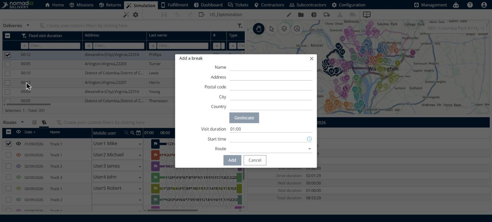

# Ajouter une pause

Cette page explique comment ajouter une pause à un itinéraire.

## Avant de commencer

* Ouvrez une simulation. Voir [Simulation](simulation.md).

## Étapes

1. Accédez à **Simulation** > **Livraisons**.
2. Cliquez sur la flèche déroulante **Livraisons**, puis cliquez sur **Ajouter une pause**.
3. Dans la fenêtre **Ajouter une pause**, saisissez un **Nom** pour la pause.
4. Saisissez l’**Adresse**, le **Code postal**, la **Ville** et le **Pays** de la pause, puis cliquez sur **Géolocaliser**.
5. Saisissez la **Durée de visite**. La valeur par défaut est **01:00**.
6. Sélectionnez l’**Heure de début**.
7. Sélectionnez l’**Itinéraire** qui reçoit la pause.
8. Cliquez sur **Ajouter**.

Cliquez sur **Annuler** pour fermer la fenêtre sans ajouter de pause.

## Résultat

La pause est ajoutée à l’itinéraire que vous avez sélectionné, avec le nom, le lieu, la durée et l’heure de début que vous avez saisis.

## Rubriques connexes

* [Gérer les livraisons](simulation-deliveries.md)
* [Afficher un itinéraire](simulation-routes-view-route.md)
