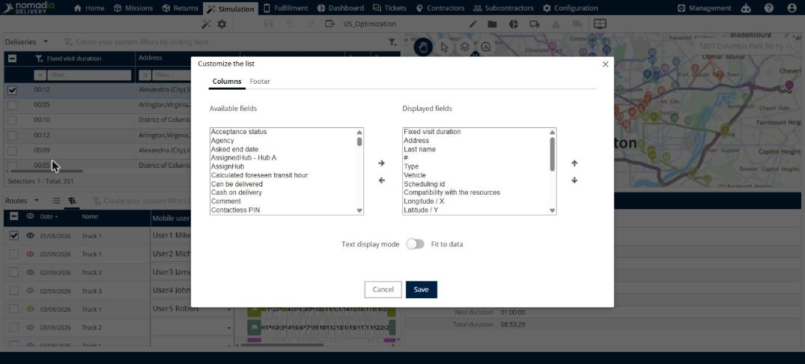
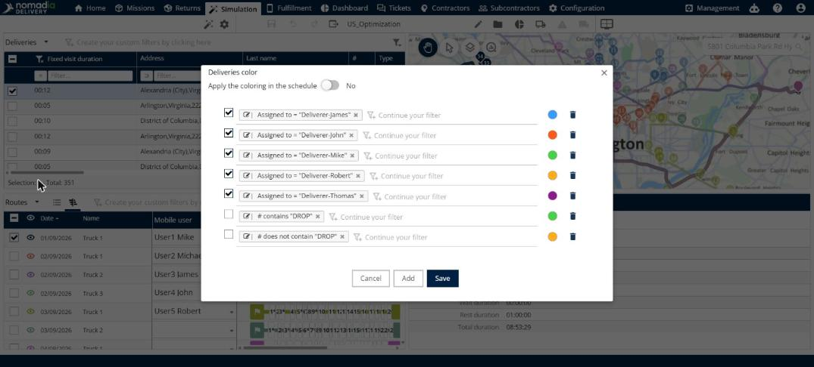

# Personnaliser la liste des livraisons

Cette page explique comment choisir les colonnes du panneau **Livraisons**, modifier les couleurs des livraisons et créer vos propres filtres.

## Avant de commencer

* Ouvrez une simulation. Voir [Simulation](simulation.md).

## Choisir les colonnes

1. Accédez à **Simulation** > **Livraisons**.
2. Cliquez sur la flèche déroulante **Livraisons**, puis cliquez sur **Personnaliser la liste**.
3. Dans l’onglet **Colonnes**, sélectionnez un ou plusieurs champs dans **Champs disponibles**, puis cliquez sur la flèche droite pour les déplacer vers **Champs affichés**.
4. Pour supprimer une colonne, sélectionnez-la dans **Champs affichés**, puis cliquez sur la flèche gauche.
5. Pour modifier l’ordre des colonnes, sélectionnez un champ dans **Champs affichés**, puis cliquez sur la flèche vers le haut ou vers le bas.
6. Facultatif : activez **Mode d’affichage du texte** pour sélectionner **Ajuster aux données**.
7. Cliquez sur **Enregistrer**.

Utilisez l’onglet **Pied de page** pour définir le pied de page du tableau. Cliquez sur **Annuler** pour fermer la fenêtre sans enregistrer.

## Modifier les couleurs

1. Cliquez sur la flèche déroulante **Livraisons**, puis cliquez sur **Coloration**.
2. Dans la fenêtre **Couleur des livraisons**, chaque ligne est une règle. Une règle comporte une condition, par exemple **Affectée à = "Deliverer-James"**, et une couleur.
3. Cochez la case d’une règle pour l’utiliser, ou cliquez sur l’icône de corbeille pour la supprimer.
4. Cliquez sur **Ajouter** pour créer une nouvelle règle.
5. Pour afficher les couleurs dans le planning, activez **Appliquer la coloration dans le planning**.
6. Cliquez sur **Enregistrer**.

## Filtrer la liste

* Saisissez une valeur dans la zone **Filtrer…** d’une colonne, puis cliquez sur l’opérateur de comparaison à côté pour modifier le fonctionnement du filtre.
* Cliquez sur **Créez vos filtres personnalisés en cliquant ici** pour créer un filtre personnalisé.
* Cliquez sur **Masquer la ligne de filtres** pour masquer les zones de filtre.

## Résultat

Le panneau **Livraisons** affiche vos colonnes, vos couleurs et vos filtres.

## Rubriques connexes

* [Gérer les livraisons](simulation-deliveries.md)
* [Personnaliser la liste des itinéraires](simulation-routes-customize-list.md)
