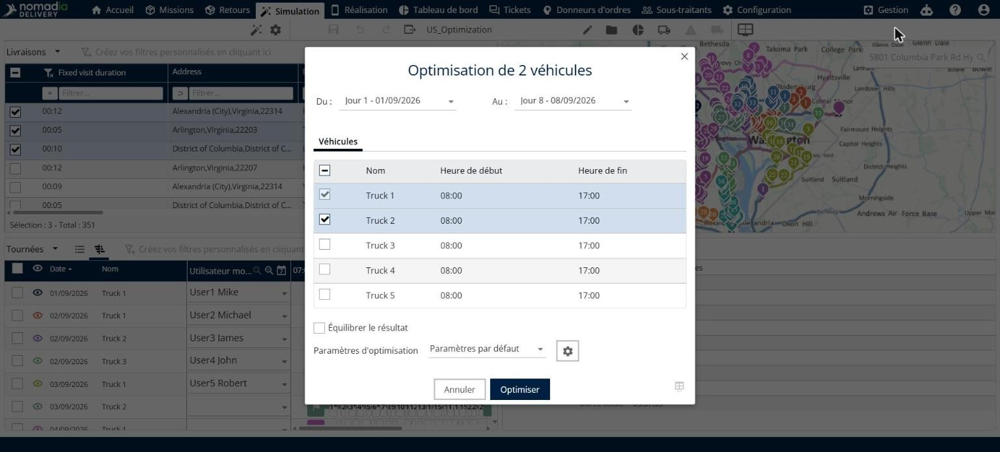
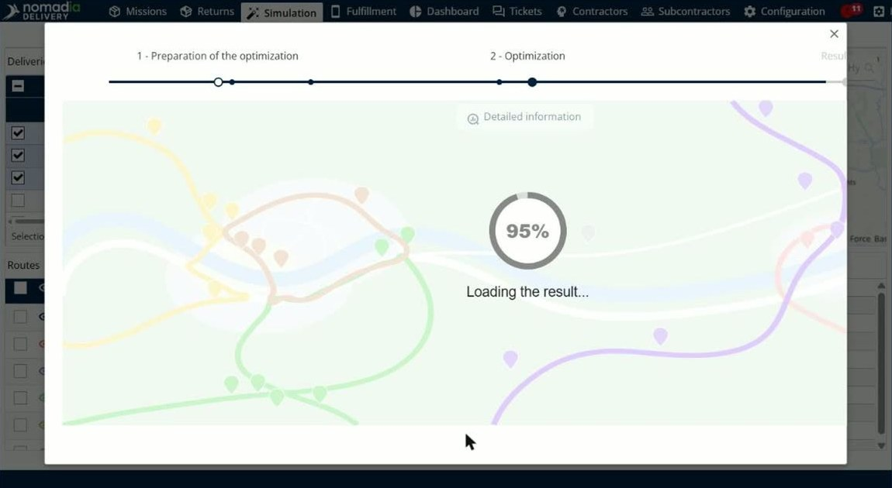

# Optimiser les livraisons

Cette page explique comment optimiser les livraisons sélectionnées dans une simulation.

## Avant de commencer

* Ouvrez une simulation. Voir [Simulation](simulation.md).
* Vérifiez que votre profil utilisateur dispose du droit **Optimisation**. Voir [Web - Rôles et droits](../manage-users/web-roles-and-rights.md).

## Quand l’utiliser

Utilisez **Optimiser** pour planifier automatiquement les livraisons sélectionnées. Vous choisissez les dates et les véhicules, vous pouvez équilibrer la charge de travail et vous sélectionnez un profil de paramètres.

## Étapes

1. Accédez à **Simulation** > **Livraisons**.
2. Cochez les cases des livraisons que vous souhaitez optimiser.
3. Cliquez sur la flèche déroulante **Livraisons**, puis sur **Optimiser**. Vous pouvez aussi cliquer sur le bouton **Optimiser** de la barre d’outils.
4. Dans la fenêtre **Optimisation**, sélectionnez le premier et le dernier jour de la période dans **Du** et **Au**, par exemple **Jour 1 - 01/09/2026** et **Jour 8 - 08/09/2026**.
5. Dans l’onglet **Véhicules**, sélectionnez les véhicules à utiliser. La liste affiche le **Nom**, l’**Heure de début** et l’**Heure de fin** de chaque véhicule. Cochez la case de la ligne d’en-tête pour sélectionner tous les véhicules.
6. Facultatif : cochez **Équilibrer le résultat**.
7. Dans **Paramètres d’optimisation**, sélectionnez la configuration à utiliser, par exemple **Paramètres par défaut**. Pour consulter ou modifier les paramètres, cliquez sur le bouton en forme d’engrenage. Voir [Configurer les paramètres d’optimisation](simulation-optimization-settings.md).
8. Cliquez sur **Optimiser**.

## Options et champs

| Option ou champ | Ce que cela fait | Remarques |
|---|---|---|
| **Du** et **Au** | Définissent le premier et le dernier jour de la période. | Par exemple **Jour 1 - 01/09/2026** et **Jour 8 - 08/09/2026**. |
| **Véhicules** | Liste les véhicules avec leur **Nom**, leur **Heure de début** et leur **Heure de fin**. | Cochez la case de chaque véhicule à utiliser. La case de l’en-tête sélectionne tous les véhicules. |
| **Équilibrer le résultat** | Équilibre la charge de travail entre les véhicules. | Non cochée par défaut. |
| **Paramètres d’optimisation** | Sélectionne le profil de paramètres à utiliser. | La valeur par défaut est **Paramètres par défaut**. Le bouton en forme d’engrenage ouvre les paramètres. |
| **Annuler** | Ferme la fenêtre sans optimiser. | |
| **Optimiser** | Lance l’optimisation. | |

## Résultat

La fenêtre affiche les deux étapes de l’optimisation, **1 - Préparation de l’optimisation** et **2 - Optimisation**, puis **Chargement du résultat...**. Les itinéraires sont recalculés en quelques secondes et le panneau **Détails** met à jour ses totaux. Par exemple, la **Distance totale** passe de 598 km à 575 km.

Lorsque l’optimisation est terminée, la fenêtre **Résultats de l’optimisation** s’ouvre. Voir [Simulation](simulation.md). Le message **Enregistrement de la simulation** apparaît en bas de la page pendant l’enregistrement de la simulation.

## Conseils


**Quitter sans optimiser** : cliquez sur **Annuler** pour fermer la fenêtre sans lancer d’optimisation.


## Rubriques connexes

* [Gérer les livraisons](simulation-deliveries.md)
* [Configurer les paramètres d’optimisation](simulation-optimization-settings.md)
* [Ordonnancer un seul itinéraire](simulation-deliveries-single-route-ordering.md)
