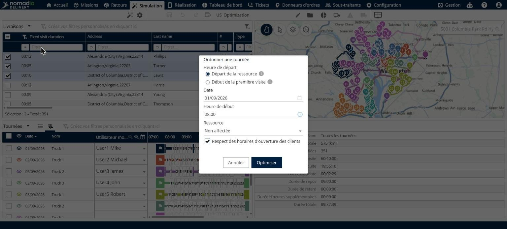
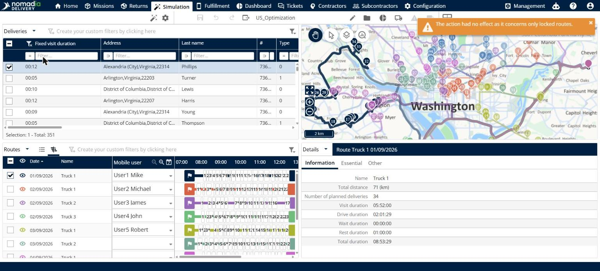

# Ordonnancer un seul itinéraire

Cette page explique comment utiliser **Ordonnancement sur un seul itinéraire** pour construire une séquence optimisée unique avec les livraisons que vous sélectionnez.

## Quand l’utiliser

Utilisez **Ordonnancement sur un seul itinéraire** lorsque vous souhaitez placer les livraisons sélectionnées sur un seul itinéraire, dans le meilleur ordre. La séquence démarre au départ de la ressource ou à la première visite, et elle respecte les horaires d’ouverture de vos clients.

## Avant de commencer

* Ouvrez une simulation. Voir [Simulation](simulation.md).
* Sélectionnez les livraisons que vous souhaitez ordonnancer.

## Étapes

1. Accédez à **Simulation** > **Livraisons**.
2. Cochez les cases des livraisons que vous souhaitez ordonnancer.
3. Cliquez sur la flèche déroulante **Livraisons**, puis sur **Ordonnancement sur un seul itinéraire**.
4. Dans **Heure de départ**, sélectionnez **Départ de la ressource** ou **Début de la première visite**.
5. Dans **Date**, sélectionnez le jour de l’itinéraire, par exemple **01/09/2026**.
6. Dans **Heure de début**, sélectionnez l’heure de début de l’itinéraire, par exemple **08:00**.
7. Dans **Ressource**, sélectionnez la ressource qui effectue l’itinéraire. La valeur par défaut est **Non affectée**.
8. Laissez **Respect des horaires d’ouverture des clients** coché pour respecter les horaires d’ouverture de vos clients.
9. Cliquez sur **Optimiser**.

Cliquez sur **Annuler** pour fermer la fenêtre sans ordonnancer l’itinéraire.

## Options et champs

| Option ou champ | Ce que cela fait | Remarques |
|---|---|---|
| **Départ de la ressource** | Démarre la séquence au départ de la ressource. | Sélectionné par défaut. Cliquez sur l’icône d’information située à côté pour plus de détails. |
| **Début de la première visite** | Démarre la séquence à la première visite. | Cliquez sur l’icône d’information située à côté pour plus de détails. |
| **Date** | Définit le jour de l’itinéraire. | Utilisez l’icône de calendrier pour choisir une date. |
| **Heure de début** | Définit l’heure de début de l’itinéraire. | Utilisez l’icône d’horloge pour choisir une heure. |
| **Ressource** | Définit la ressource de l’itinéraire. | La valeur par défaut est **Non affectée**. |
| **Respect des horaires d’ouverture des clients** | Respecte les horaires d’ouverture de vos clients lors de la construction de la séquence. | Sélectionné par défaut. |

## Résultat

Les livraisons sélectionnées sont ordonnancées sur un seul itinéraire.

Si l’action concerne uniquement des itinéraires verrouillés, rien ne change et le message **« L’action n’a eu aucun effet car elle concerne uniquement des itinéraires verrouillés. »** apparaît dans le coin supérieur droit. Pour modifier un itinéraire verrouillé, déverrouillez-le d’abord. Voir [Verrouiller et déverrouiller des itinéraires](simulation-routes-lock-unlock.md).

## Rubriques connexes

* [Gérer les livraisons](simulation-deliveries.md)
* [Optimiser les livraisons](simulation-deliveries-optimize.md)
* [Verrouiller et déverrouiller des livraisons](simulation-deliveries-lock-unlock.md)
