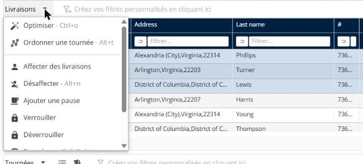

# Gérer les livraisons

Cette page explique comment utiliser le panneau **Livraisons** pour retrouver des livraisons dans une simulation et modifier leur planification.

## Avant de commencer

* Ouvrez une simulation. Voir [Simulation](simulation.md).

## Colonnes

Le panneau affiche une ligne par livraison. Par défaut, les colonnes comprennent **Durée de visite fixe**, **Adresse**, **Nom**, **N°**, **Type**, **Véhicule**, **Identifiant de planification**, **Compatibilité avec les ressources**, **Longitude / X**, **Latitude / Y**, **Code postal**, **Pays**, **Identifiant**, **Planifiée**, **Verrouillée**, **Visite dupliquée par fréquence**, **Motif**, **Affectée à**, **Jour planifié** et **Heure planifiée**. Pour choisir d’autres colonnes, voir [Personnaliser la liste des livraisons](simulation-deliveries-customize-list.md).

## Étapes

1. Accédez à **Simulation** > **Livraisons**.
2. Saisissez une valeur dans la zone **Filtrer…** d’une colonne pour filtrer la liste.
3. Cliquez sur l’opérateur de comparaison situé à côté de la zone de filtre, par exemple **égal à** ou **contient**, pour modifier le fonctionnement du filtre.
4. Cochez les cases des livraisons que vous souhaitez modifier.
5. Cliquez sur la flèche déroulante **Livraisons**. Le menu liste **Optimiser**, **Ordonnancement sur un seul itinéraire**, **Affecter des livraisons**, **Désaffecter**, **Ajouter une pause**, **Verrouiller**, **Déverrouiller**, **Supprimer**, **Personnaliser la liste** et **Coloration**.
6. Cliquez sur une action. Chaque action est décrite dans sa propre rubrique, listée sous **Fonctionnalités**.

## Fonctionnalités

* [Optimiser les livraisons](simulation-deliveries-optimize.md) : optimisez les livraisons sélectionnées sur une période, avec les véhicules de votre choix.
* [Ordonnancer un seul itinéraire](simulation-deliveries-single-route-ordering.md) : ordonnancez les livraisons sélectionnées sur un seul itinéraire.
* [Affecter des livraisons à un itinéraire](simulation-deliveries-assign.md) : choisissez l’itinéraire et le créneau horaire d’une livraison.
* [Désaffecter des livraisons](simulation-deliveries-unassign.md) : retirez les livraisons sélectionnées de leurs itinéraires.
* [Ajouter une pause](simulation-deliveries-add-break.md) : ajoutez une pause à un itinéraire.
* [Verrouiller et déverrouiller des livraisons](simulation-deliveries-lock-unlock.md) : conservez les livraisons en l’état, ou rendez-les à nouveau modifiables.
* [Supprimer des livraisons](simulation-deliveries-delete.md) : retirez les livraisons sélectionnées de la simulation.
* [Personnaliser la liste des livraisons](simulation-deliveries-customize-list.md) : choisissez les colonnes, modifiez les couleurs et créez des filtres.
* [Colorer les livraisons](simulation-deliveries-coloring.md) : appliquez des règles de coloration, comme une couleur par livreur.

## Résultat

Le pied de page indique le nombre de livraisons sélectionnées et le total, par exemple **Sélection : 1 - Total : 351**.

## Rubriques connexes

* [Simulation](simulation.md)
* [Gérer les itinéraires](simulation-routes.md)
* [Afficher la carte](simulation-map.md)
