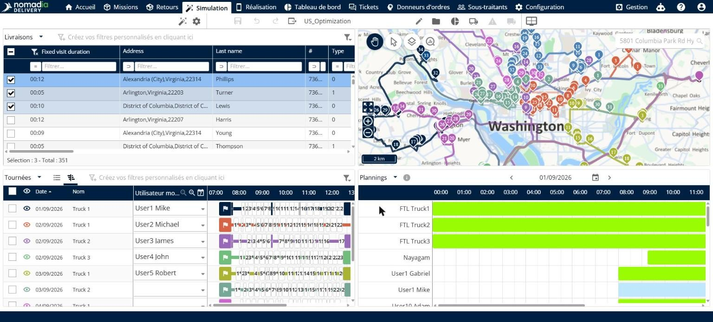

# Consulter les agendas

Cette page explique comment utiliser la vue **Agendas** pour voir quand vos ressources sont disponibles.

## Avant de commencer

* Ouvrez une simulation. Voir [Simulation](simulation.md).

## Étapes

1. Accédez à **Simulation** > **Détails**.
2. Cliquez sur la flèche de la liste déroulante à côté du titre du panneau, puis cliquez sur **Agendas**.
3. Lisez la chronologie. Chaque ligne correspond à une ressource, et les heures de la journée figurent en haut.
4. Pour changer de jour, cliquez sur les flèches de chaque côté de la date, ou cliquez sur l’icône de calendrier.
5. Pour voir la signification des couleurs, cliquez sur l’icône d’information à côté du titre du panneau.

## Résultat

Les couleurs indiquent **Disponible** (vert), **Affecté** (bleu) et **Indisponible** (gris).

## Rubriques connexes

* [Consulter les détails d’un itinéraire](simulation-details.md)
* [Gérer les itinéraires](simulation-routes.md)
