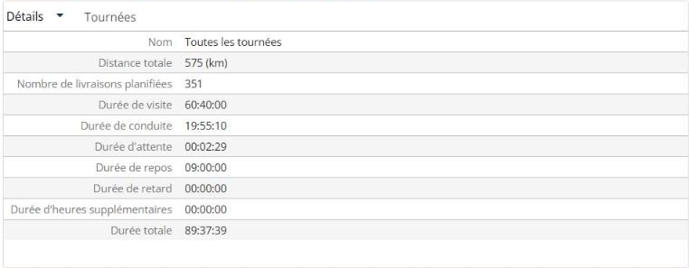
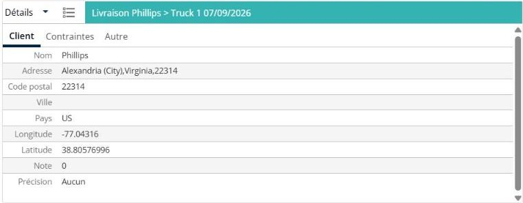

# Consulter les détails d’un itinéraire

Cette page explique comment utiliser le panneau **Détails** pour consulter les totaux de vos itinéraires.

## Avant de commencer

* Ouvrez une simulation. Voir [Simulation](simulation.md).

## Étapes

1. Accédez à **Simulation** > **Détails**.
2. Cliquez sur la flèche de la liste déroulante **Détails**.
3. Cliquez sur **Détails** pour consulter les totaux, ou sur **Agendas** pour consulter les agendas. Voir [Consulter les agendas](simulation-details-agendas.md).
4. Pour consulter les totaux d’un itinéraire, ouvrez l’itinéraire dans le panneau **Itinéraires**. Voir [Consulter un itinéraire](simulation-routes-view-route.md).

Pour consulter les informations d’une livraison, cliquez sur la livraison dans le panneau **Livraisons**. Le titre du panneau devient la livraison et son itinéraire, par exemple **Livraison Phillips > Camion 1 07/09/2026**, et les informations s’affichent dans les onglets **Client**, **Contraintes** et **Autre**. L’onglet **Client** affiche **Nom**, **Adresse**, **Code postal**, **Ville**, **Pays**, **Longitude**, **Latitude** et **Score**.

## Fonctionnalités

* [Consulter les agendas](simulation-details-agendas.md) : voyez quand vos ressources sont disponibles, affectées ou indisponibles.

## Résultat

La vue **Détails** affiche **Nom**, **Distance totale**, **Nombre de livraisons planifiées**, **Durée de visite**, **Durée de conduite**, **Durée d’attente**, **Durée de repos**, **Durée de retard**, **Durée des heures supplémentaires** et **Durée totale**. Lorsqu’aucun itinéraire n’est sélectionné, **Nom** affiche **Tous les itinéraires**. Lorsque vous ouvrez un itinéraire, le panneau affiche cet itinéraire dans les onglets **Informations**, **Essentiel** et **Autre**.

## Rubriques connexes

* [Simulation](simulation.md)
* [Gérer les itinéraires](simulation-routes.md)
* [Consulter un itinéraire](simulation-routes-view-route.md)
