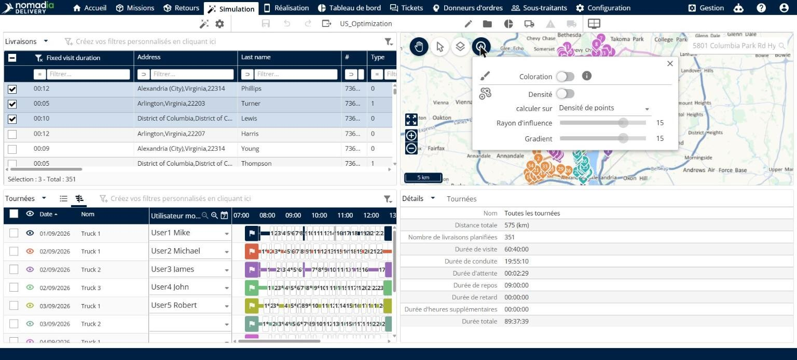

# Utiliser les informations graphiques

Cette page explique comment utiliser **Informations graphiques** pour colorer la carte ou afficher la densité des points qui s’y trouvent.

## Avant de commencer

* Ouvrez une simulation. Voir [Simulation](simulation.md).

## Étapes

1. Accédez à **Simulation** > **Carte**.
2. Cliquez sur **Informations graphiques**.
3. Activez **Coloration** pour colorer la carte. Cliquez sur l’icône d’information à côté pour en savoir plus sur cette option.
4. Activez **Densité** pour afficher la densité des points sur la carte.
5. Pour **Densité**, définissez les options suivantes :
   * **calculer sur** : sélectionnez l’élément sur lequel la densité est calculée, par exemple **Densité de points**.
   * **Rayon d’influence** : déplacez le curseur.
   * **Dégradé** : déplacez le curseur.

## Résultat

La carte affiche les options que vous avez activées.

## Rubriques connexes

* [Afficher la carte](simulation-map.md)
* [Choisir ce qu’affiche la carte](simulation-map-objects-visibility.md)
