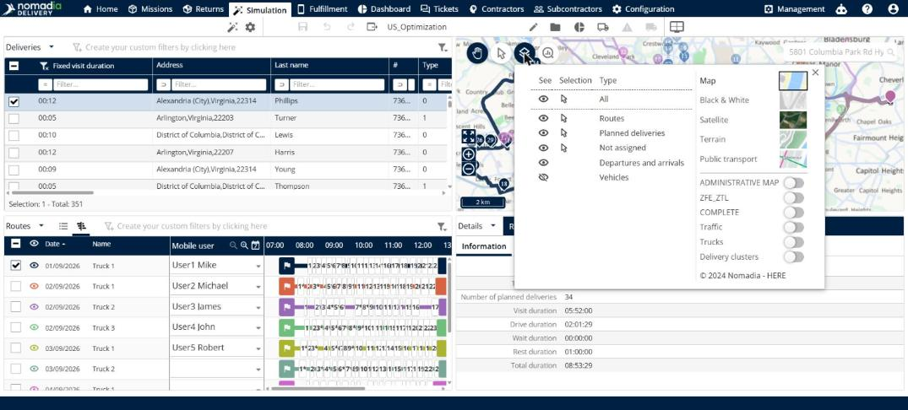

# Choisir ce qu’affiche la carte

Cette page explique comment utiliser **Visibilité des objets** pour choisir les objets, le style de carte et les calques du panneau **Carte**.

## Avant de commencer

* Ouvrez une simulation. Voir [Simulation](simulation.md).

## Étapes

1. Accédez à **Simulation** > **Carte**.
2. Cliquez sur **Visibilité des objets**.
3. Dans le tableau de gauche, utilisez la colonne **Voir** pour afficher ou masquer un type d’objet, et la colonne **Sélection** pour choisir ce que vous pouvez sélectionner avec l’outil **Sélection**. Les types sont **Tous**, **Itinéraires**, **Livraisons planifiées**, **Non affectées**, **Départs et arrivées** et **Véhicules**.
4. Sur la droite, sélectionnez un style de carte : **Carte**, **Noir et blanc**, **Satellite**, **Relief** ou **Transports en commun**.
5. Utilisez les interrupteurs pour activer ou désactiver un calque : **CARTE ADMINISTRATIVE**, **ZFE_ZTL**, **COMPLET**, **Trafic**, **Poids lourds** ou **Clusters de livraisons**.

## Résultat

La carte affiche les objets, le style et les calques que vous avez choisis.

## Rubriques connexes

* [Afficher la carte](simulation-map.md)
* [Utiliser les informations graphiques](simulation-map-graphical-information.md)
