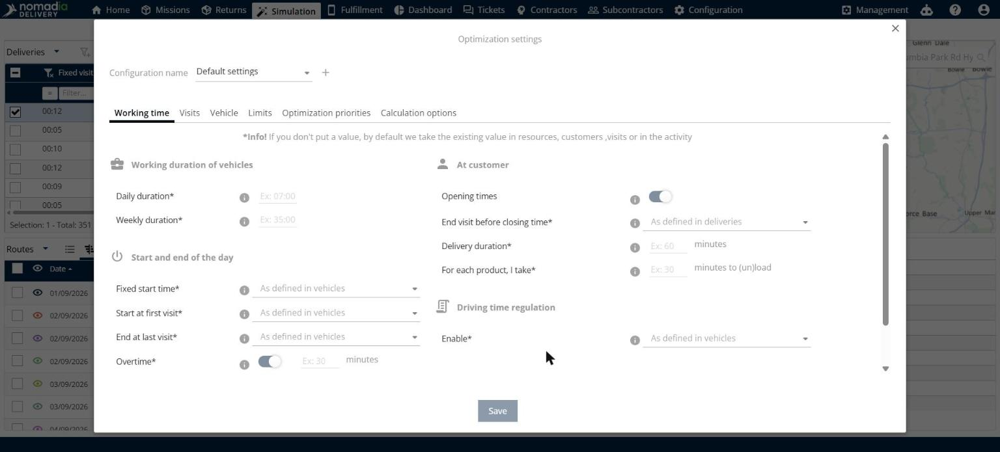
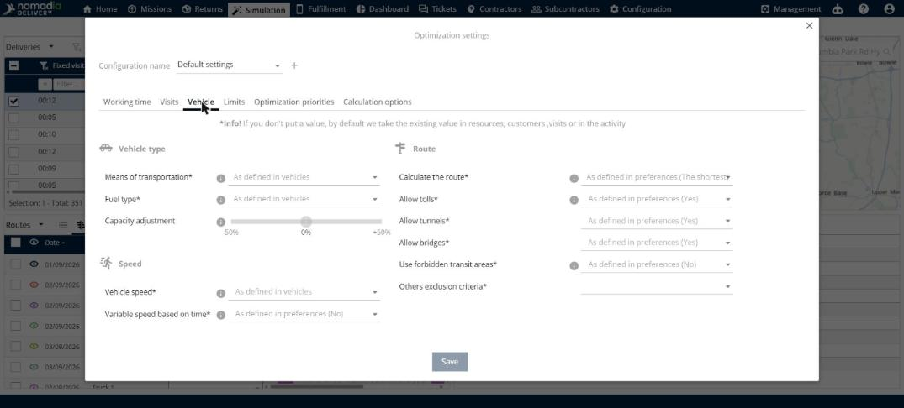
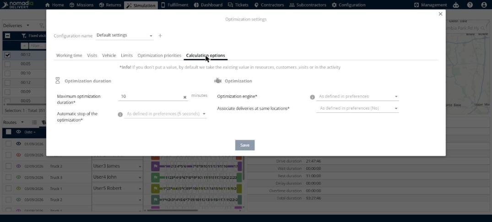

# Configurer les paramètres d’optimisation

Cette page explique comment utiliser la fenêtre **Paramètres d’optimisation** pour définir les paramètres utilisés par une optimisation.

## Avant de commencer

* Ouvrez une simulation. Voir [Simulation](simulation.md).
* Vérifiez que votre profil utilisateur dispose du droit **Modifier les paramètres d’optimisation**. Voir [Web - Rôles et droits](../manage-users/web-roles-and-rights.md).

## Étapes

1. Ouvrez la fenêtre **Optimisation**. Voir [Optimiser les livraisons](simulation-deliveries-optimize.md).
2. Cliquez sur le bouton en forme d’engrenage situé à côté de **Paramètres d’optimisation**.
3. Dans **Nom de la configuration**, sélectionnez une configuration, ou cliquez sur **+** pour en créer une nouvelle.
4. Ouvrez un onglet et saisissez vos valeurs. Les onglets sont décrits ci-dessous.
5. Cliquez sur **Enregistrer** pour conserver vos valeurs, ou sur **Tout optimiser** pour lancer une optimisation avec ces valeurs.

Vous pouvez aussi ouvrir les paramètres avec le bouton **Paramètres d’optimisation** situé à gauche de la barre d’outils.

Si vous laissez un champ vide, l’optimisation utilise la valeur déjà définie pour les ressources, les clients, les livraisons ou l’activité.

## Temps de travail

* **Durée de travail des véhicules** : **Durée quotidienne** et **Durée hebdomadaire**.
* **Début et fin de journée** : **Heure de début fixe**, **Début à la première visite**, **Fin à la dernière visite** et **Heures supplémentaires** (un interrupteur et un nombre de minutes).
* **Chez le client** : **Horaires d’ouverture** (un interrupteur), **Terminer la visite avant la fermeture**, **Durée de livraison** (en minutes) et les minutes nécessaires pour charger ou décharger chaque produit.
* **Réglementation du temps de conduite** : **Activer**.

## Visites

* **Ignorer le coût de sous-traitance** : un interrupteur.

## Véhicule

* **Type de véhicule** : **Moyen de transport**, **Type de carburant** et **Ajustement de la capacité** (un curseur de -50 % à +50 %).
* **Vitesse** : **Vitesse du véhicule** et **Vitesse variable selon l’heure**.
* **Itinéraire** : **Calculer l’itinéraire**, **Autoriser les péages**, **Autoriser les tunnels**, **Autoriser les ponts**, **Utiliser les zones de transit interdites** et **Autres critères d’exclusion**.

## Limites

* **Distance quotidienne maximale** (en km).
* **Secteurs / Ressources affectées** : un interrupteur.
* **Nombre maximal de visites par jour**.
* **Nombre maximal de rechargements/déchargements**.
* **Nombre maximal de nuits consécutives à l’extérieur** et **Nombre maximal de nuits à l’extérieur par semaine**.

## Priorités d’optimisation

Utilisez cet onglet pour indiquer à l’optimisation ce qui est important pour vous. Définissez une valeur pour chaque priorité :

* **Réduire les kilomètres**.
* **Réduire la plage horaire de travail**.
* **Réaliser le maximum de visites**.
* **Utiliser le moins de ressources possible**.

La zone **Conseils** propose trois étapes : cliquez sur l’icône d’information pour consulter la documentation, définissez vos priorités, puis accédez à des onglets tels que **Véhicule** et **Temps de travail** pour activer les paramètres qui soutiennent vos priorités.

## Options de calcul

* **Durée de l’optimisation** : **Durée maximale de l’optimisation** (en minutes) et **Arrêt automatique de l’optimisation**.
* **Optimisation** : **Moteur d’optimisation** et **Associer les livraisons aux mêmes adresses**.

## Résultat

Vos valeurs sont enregistrées dans la configuration que vous avez sélectionnée.

## Conseils


**Icônes d’information** : cliquez sur l’icône d’information située à côté d’un paramètre pour en savoir plus.


## Rubriques connexes

* [Optimiser les livraisons](simulation-deliveries-optimize.md)
* [Gérer les livraisons](simulation-deliveries.md)
