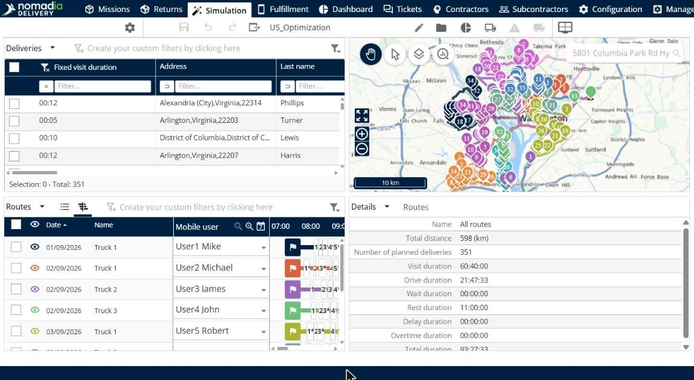
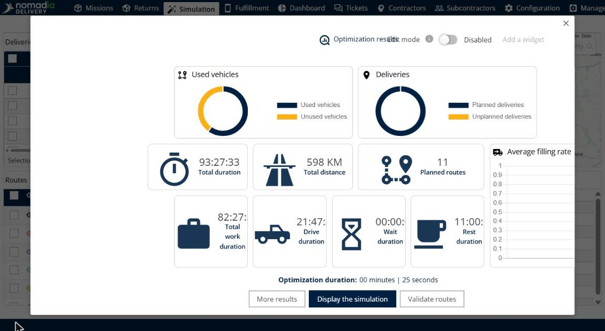

# Simulation

Le module **Simulation** affiche le résultat d’une optimisation d’itinéraires afin que vous puissiez examiner, ajuster et valider les itinéraires avant que vos livreurs ne les utilisent.


**Panneaux** : la page Simulation affiche des panneaux, et non des onglets, et chaque panneau dispose de sa propre rubrique dans ce guide. Cliquez sur **Modifier l’affichage des panneaux** pour choisir les panneaux que vous voyez.


## Avant de commencer

* Vérifiez que votre profil utilisateur dispose des droits nécessaires pour les simulations. Par exemple, **Optimisation** donne accès aux fonctionnalités d’optimisation, **Planning** vous permet de créer et de gérer des plannings optimisés, et **Voir les simulations des autres personnes** et **Modifier les simulations des autres personnes** vous permettent de travailler avec les simulations créées par d’autres utilisateurs. Voir [Web - Rôles et droits](../manage-users/web-roles-and-rights.md).
* Lancez une optimisation depuis l’onglet **Missions**. Une simulation affiche le résultat de cette optimisation.

La page comporte une barre d’outils et quatre panneaux : **Livraisons**, **Carte**, **Itinéraires** et **Détails**. Le nom de la simulation, par exemple **US_Optimization**, s’affiche dans la barre d’outils.

* À gauche de la barre d’outils : **Paramètres d’optimisation**, **Enregistrer les modifications**, **Annuler**, **Rétablir** et **Exporter**.
* À droite de la barre d’outils : **Modifier**, **Voir la liste des simulations**, **Résultats de l’optimisation**, **Voir les véhicules utilisés et non utilisés dans l’optimisation** et **Modifier l’affichage des panneaux**.

## Fonctionnalités

* [Gérer les livraisons](simulation-deliveries.md) : retrouvez les livraisons de la simulation et optimisez-les, affectez-les, désaffectez-les, verrouillez-les ou supprimez-les.
* [Consulter la carte](simulation-map.md) : visualisez les livraisons et les itinéraires sur une carte et choisissez ce que la carte affiche.
* [Gérer les itinéraires](simulation-routes.md) : examinez, validez, réordonnez, inversez, affectez et verrouillez les itinéraires.
* [Consulter les détails d’un itinéraire](simulation-details.md) : consultez les totaux de distance, de livraisons et de durées, ainsi que les agendas de vos ressources.
* [Analyser les résultats](simulation-analysis.md) : accédez aux graphiques d’analyse pour mieux comprendre les résultats.
* [Consulter les itinéraires validés](simulation-validated-routes.md) : consultez les itinéraires que vous avez validés par itinéraire, par date et par livreur.

## Résultat

Lorsque l’optimisation se termine, la fenêtre **Résultats de l’optimisation** s’ouvre. Elle affiche **Véhicules utilisés**, **Livraisons**, **Durée totale**, **Distance totale**, **Itinéraires planifiés**, **Durée de travail totale**, **Durée de conduite**, **Durée d’attente**, **Durée de repos**, **Taux de remplissage moyen** et **Durée de l’optimisation**. Depuis cette fenêtre, vous pouvez cliquer sur **Plus de résultats**, **Afficher la simulation** ou **Valider les itinéraires**.

## Conseils


**Rouvrir les résultats** : cliquez sur **Résultats de l’optimisation** dans la barre d’outils pour ouvrir la fenêtre **Résultats de l’optimisation**.



**Modifier la disposition des panneaux** : cliquez sur **Modifier l’affichage des panneaux**, puis faites glisser le nom d’un panneau, par exemple **Analyse**, sur la page pour l’ajouter. Cliquez sur **Annuler les modifications de la disposition** ou **Réinitialiser la disposition** pour revenir en arrière.



**Boutons de la barre d’outils** : utilisez **Optimiser**, **Consulter et modifier les paramètres**, **Enregistrer les modifications**, **Exporter**, **Modifier**, **Voir la liste des simulations**, **Résultats de l’optimisation** et **Voir les véhicules utilisés et non utilisés dans l’optimisation** depuis la barre d’outils en haut de la page.



**Simulation obsolète** : une icône d’avertissement s’affiche lorsque votre configuration, vos paramètres d’optimisation ou votre flotte ont changé après la création de la simulation. Pour utiliser les nouveaux paramètres, accédez à l’onglet **Missions** et lancez une nouvelle optimisation.



**Déroulement type** : optimisez les livraisons, ajustez le plan avec les actions sur les livraisons et sur les itinéraires, vérifiez les totaux dans le panneau **Détails**, puis enregistrez la simulation et validez les itinéraires.


## Rubriques connexes

* [Web - Rôles et droits](../manage-users/web-roles-and-rights.md)
* [Gérer les livraisons](simulation-deliveries.md)
* [Gérer les itinéraires](simulation-routes.md)
