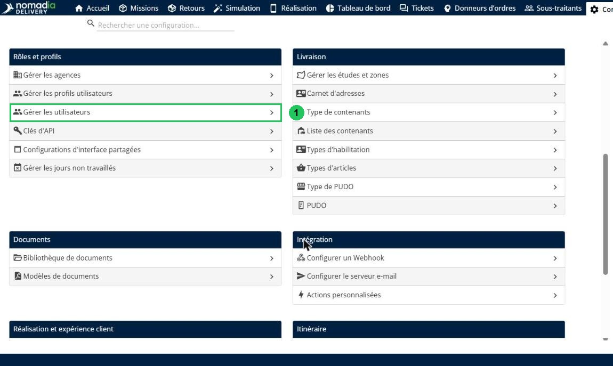
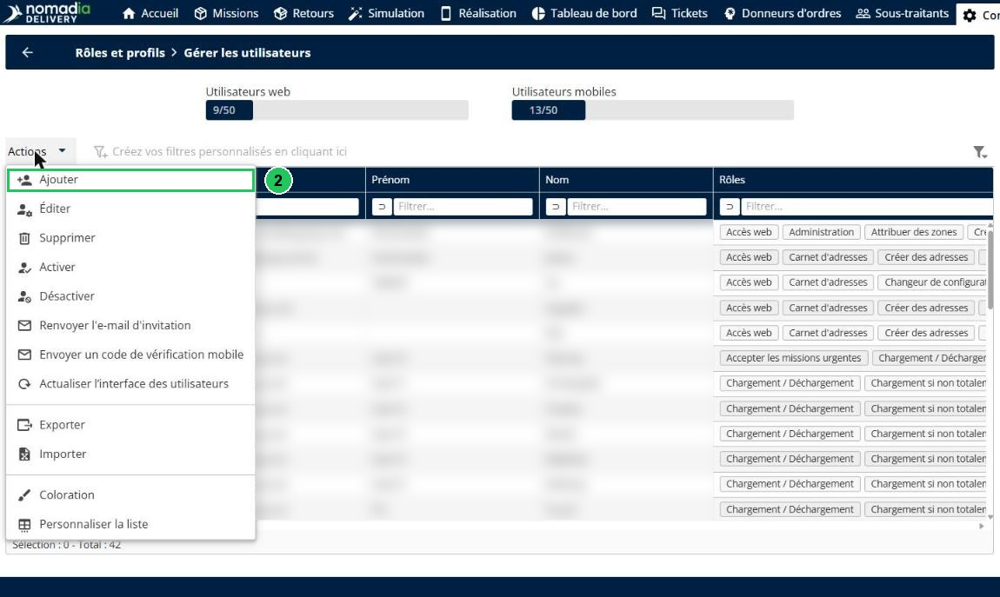
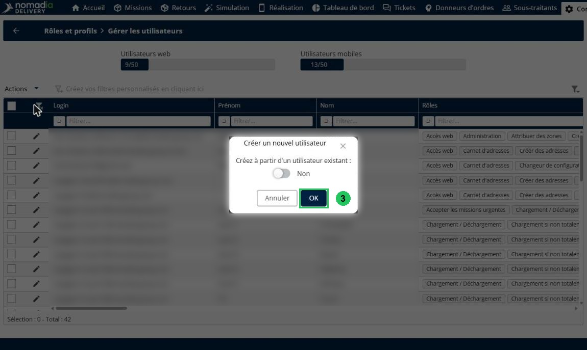
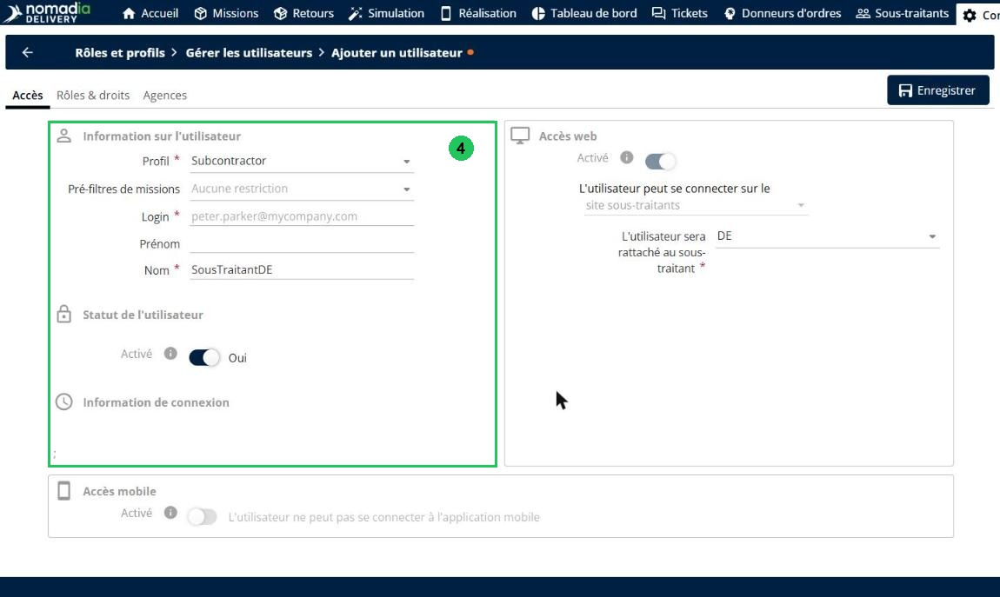
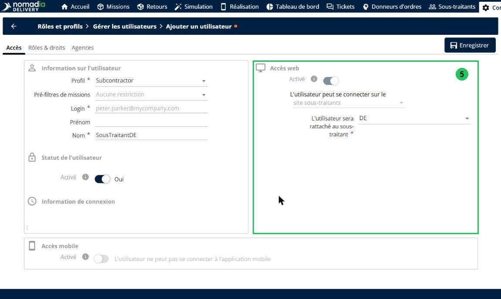
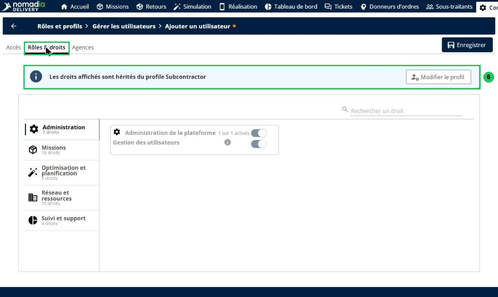
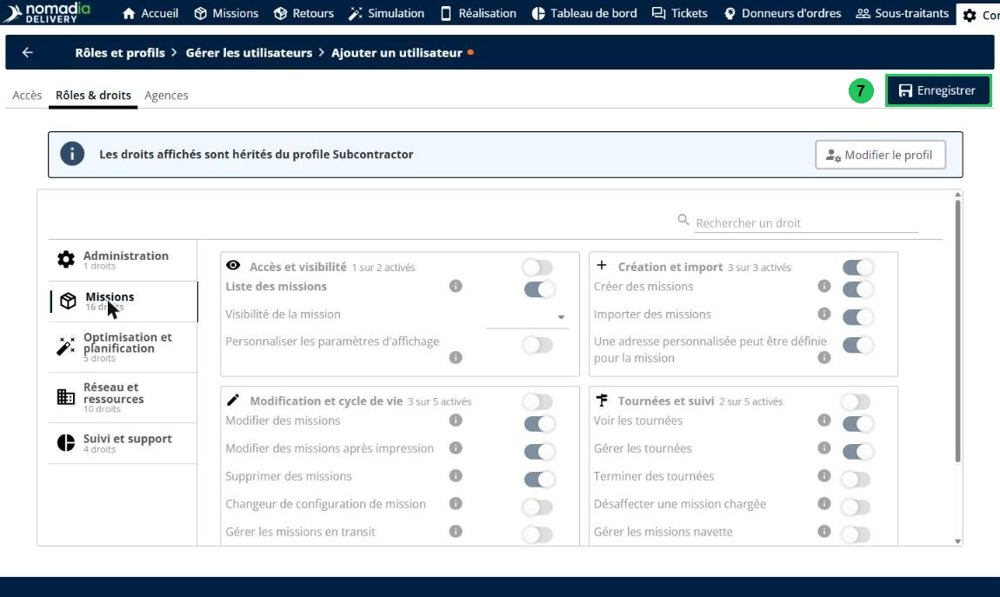

# Créer un utilisateur sous-traitant

Les transporteurs peuvent affecter des utilisateurs à chaque sous-traitant afin de gérer plus efficacement les tâches de planification et d’exécution. Cette fonctionnalité permet de créer des planificateurs et des livreurs dédiés pour chaque sous-traitant, garantissant une gestion fluide et efficace des opérations logistiques.

## Avant de commencer

* Connectez-vous à **Nomadia Delivery** en tant que transporteur avec un profil utilisateur pouvant accéder à **Configuration** > **Gérer les utilisateurs**.
* Créez d’abord le sous-traitant dans le module Sous-traitants, car vous le sélectionnez pour le lier au nouvel utilisateur.

## Présentation de la fonctionnalité

* Onglet **Accès**, section **Information sur l’utilisateur** : contient le profil, le login, le nom et le statut du nouvel utilisateur.
* Onglet **Accès**, section **Accès web** : active l’accès web de l’utilisateur et le lie au site sous-traitants et au bon sous-traitant.
* Onglet **Rôles & droits** : affiche les droits, que le système attribue automatiquement en fonction de l’utilisateur.
* **Actions** > **Ajouter** : lance la création d’un nouvel utilisateur, à partir de zéro ou à partir d’un utilisateur existant.

## Créer un utilisateur sous-traitant

1. Ouvrez l’application Nomadia Delivery et accédez à **Configuration** > **Gérer les utilisateurs**.

2. Cliquez sur le bouton **Actions** et sélectionnez **Ajouter**.

3. Cliquez sur **OK** pour créer un nouvel utilisateur. Vous pouvez également créer un utilisateur à partir d’un utilisateur existant. Cela accélère le processus en copiant tous les paramètres de l’utilisateur existant vers le nouvel utilisateur.

4. Dans l’onglet **Accès**, section **Information sur l’utilisateur**, saisissez le profil, le login et le nom de l’utilisateur, puis activez le statut de l’utilisateur.
5. Accédez à la section **Accès web**.

6. Activez l’accès web pour l’utilisateur et sélectionnez le site sous-traitants dans la liste déroulante.

7. Sélectionnez le bon sous-traitant (créé dans le module Sous-traitants) à associer à cet utilisateur.
8. Accédez à l’onglet **Rôles & droits**. Le système attribue automatiquement les droits en fonction de l’utilisateur.

9. Enregistrez le nouvel utilisateur. Le sous-traitant reçoit une notification par e-mail avec les instructions pour créer un mot de passe et activer le compte.

## Activer le compte du sous-traitant

Le sous-traitant doit effectuer les étapes suivantes :

1. Cliquez sur le lien de vérification dans l’e-mail.
2. Saisissez le code de vérification reçu par e-mail et cliquez sur **Vérifier le code**.
3. Cliquez sur **Continuer**.
4. Saisissez et confirmez un nouveau mot de passe, puis cliquez sur **Continuer**.
5. Acceptez le contrat de licence de l’utilisateur final, puis cliquez sur **Continuer**.

## Conseils


**Sous-traitant manquant** : si aucun sous-traitant n’apparaît dans la liste, assurez-vous qu’un sous-traitant a été créé dans le module Sous-traitants.


## Rubriques connexes

* [Gestion des sous-traitants](README.md)
* [Enregistrer un sous-traitant](register-a-subcontractor.md)
* [Affectation des missions au sous-traitant](assigning-missions-to-subcontractor.md)
* [Créer un utilisateur à partir d’un utilisateur existant](../manage-users/creating-a-user-from-an-existing-user.md)
