# Plan d’itinéraire optimisé pour les sous-traitants

En tant que sous-traitant, vous disposez désormais d’une flexibilité accrue pour planifier et gérer vos missions ou vos livraisons. Cette amélioration permet aux sous-traitants d’optimiser leurs itinéraires de manière autonome à l’aide de notre algorithme avancé, en réduisant au minimum la dépendance aux instructions du transporteur.

## Avant de commencer

Avant que les sous-traitants puissent créer des itinéraires optimisés, ils doivent d’abord être autorisés par le transporteur principal. Le transporteur attribue les permissions nécessaires de la manière suivante :

1. Accédez au module **Configuration**.
2. Ouvrez la section **Gérer les profils utilisateurs**.

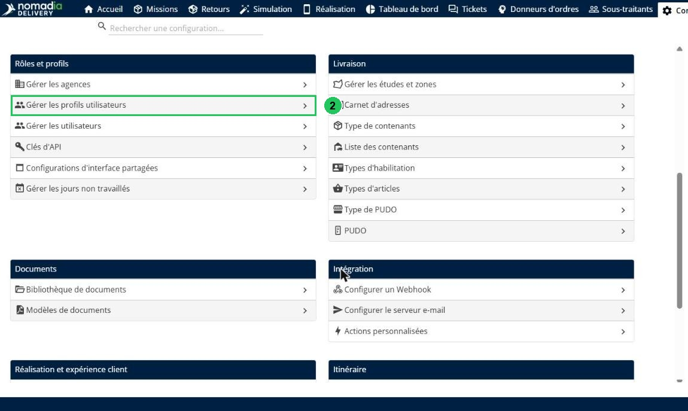

3. Mettez à jour l’accès du sous-traitant en activant les droits **Véhicules** et **Optimisation**.

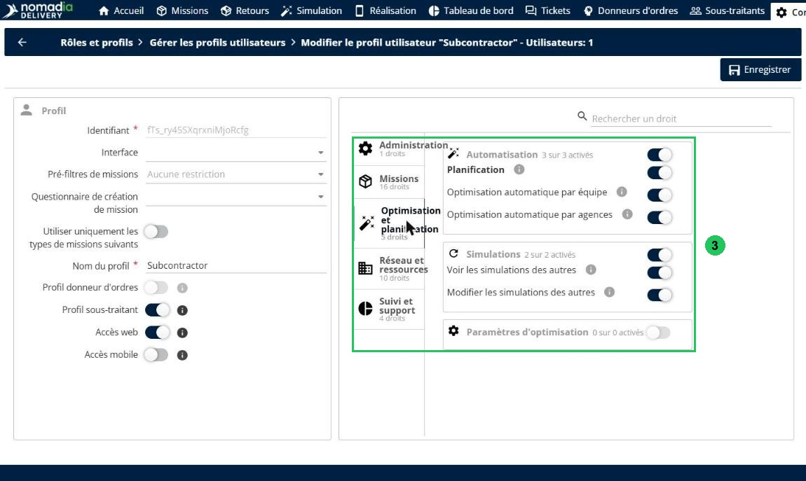

4. Une fois ces autorisations accordées, les sous-traitants peuvent se connecter et utiliser les fonctionnalités d’optimisation d’itinéraires.

<figure><figcaption></figcaption></figure>

## Présentation de la fonctionnalité

* Droits **Véhicules** et **Optimisation** : permissions que le transporteur active dans **Gérer les profils utilisateurs** pour que les sous-traitants puissent utiliser l’optimisation d’itinéraires.
* **Optimiser** : lance l’optimisation des missions sélectionnées, selon la plage de dates, l’équipe et les véhicules que vous définissez.
* **Arrêter** : met fin à l’optimisation lorsque le résultat vous satisfait afin que vous puissiez le consulter.
* **Afficher la simulation** : vous permet d’analyser les résultats de l’optimisation.
* **Valider les itinéraires** : publie directement les résultats sans les examiner.
* **Publier sur l’appli mobile** : partage l’itinéraire validé avec le livreur.
* **Forcer** : valide l’itinéraire même lorsque des conflits sont listés.

## Lancer l’optimisation avec la connexion sous-traitant

1. Connectez-vous à l’application Nomadia Delivery avec le compte sous-traitant.
2. Accédez à l’onglet **Missions**.
3. Sélectionnez les missions à optimiser, cliquez sur le bouton **Actions**, puis choisissez **Optimiser**.

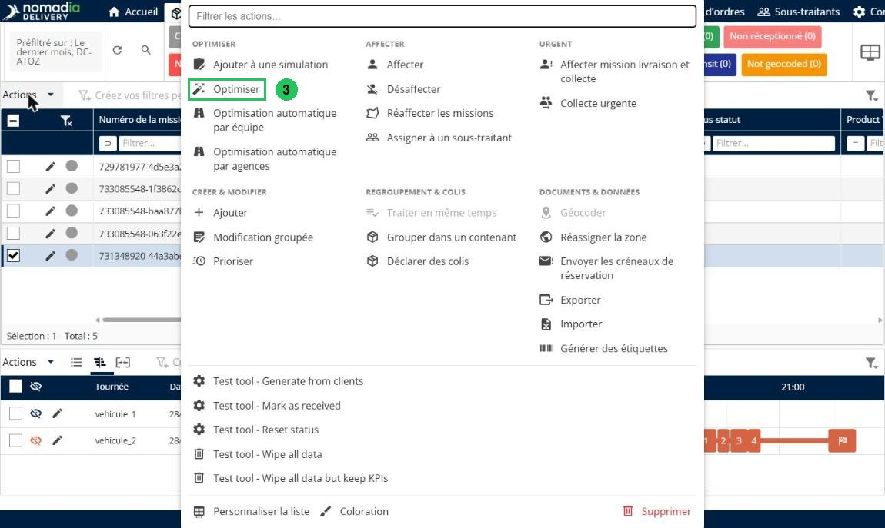

4. Définissez le périmètre de l’optimisation en sélectionnant la plage de dates, l’équipe et les véhicules, puis cliquez sur **Optimiser**.

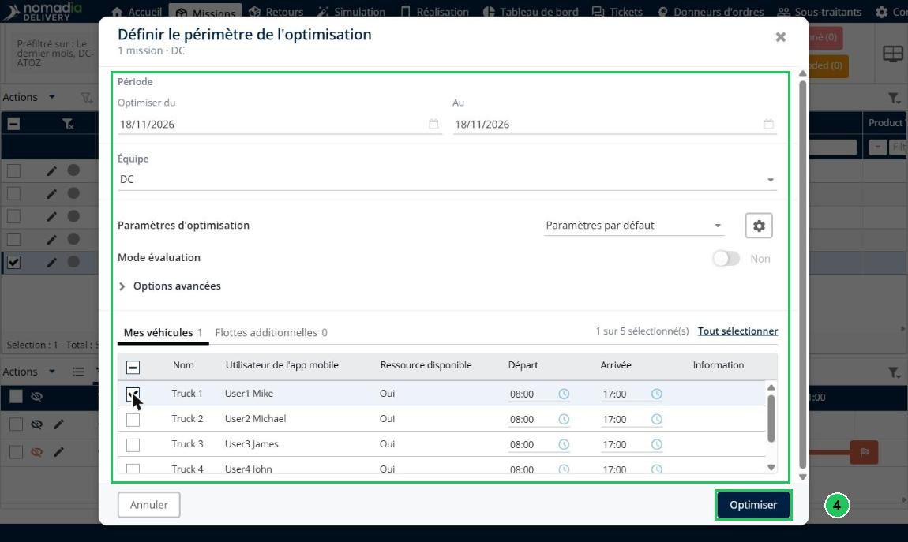

5. Lorsque le résultat vous satisfait, cliquez sur **Arrêter et voir le résultat**.

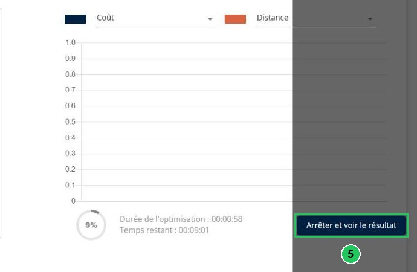

6. Consultez le récapitulatif de l’optimisation qui s’affiche. Cliquez sur **Afficher la simulation** pour analyser les résultats.

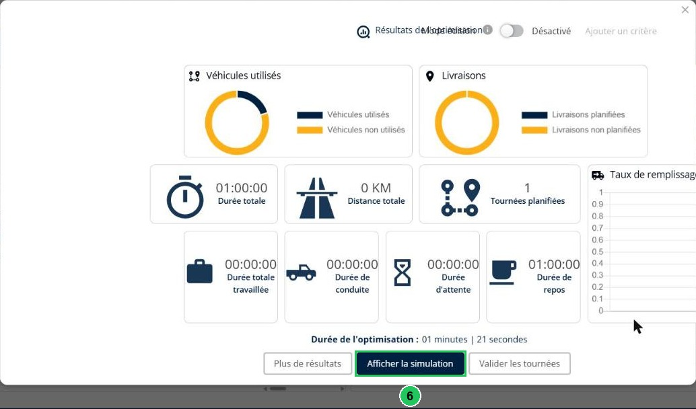

Vous pouvez également cliquer sur **Valider les tournées** pour publier directement les résultats sans les examiner.

## Valider et publier les itinéraires

1. Dans le panneau **Itinéraires**, sélectionnez les itinéraires à valider.
2. Ouvrez le menu **Actions**, puis cliquez sur **Valider**.

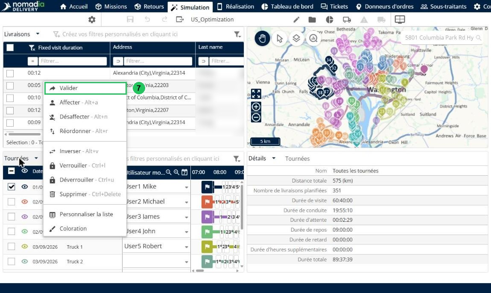

3. Confirmez en cliquant sur **OK**.

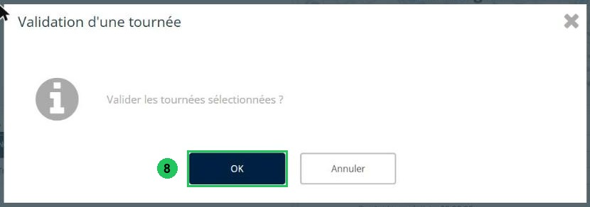

4. Consultez la notification de confirmation qui s’affiche. L’itinéraire est validé.

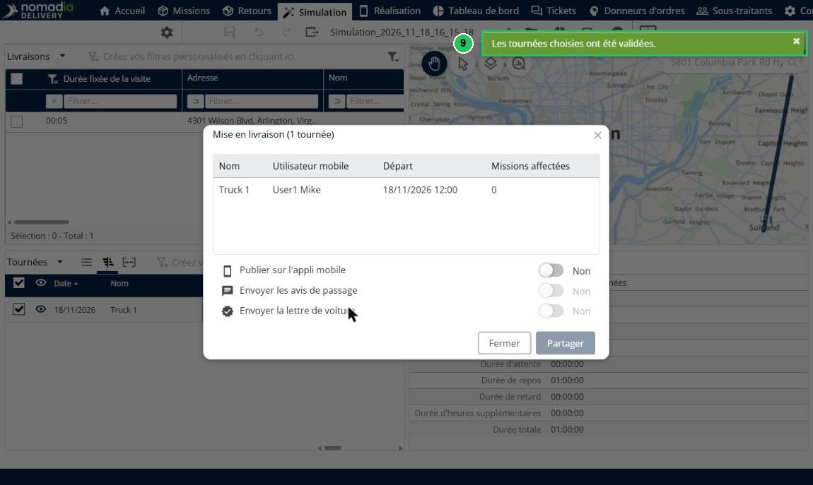

5. Dans la fenêtre **Mise en livraison**, activez **Publier sur l’appli mobile**, puis cliquez sur **Partager** pour partager l’itinéraire avec le livreur.

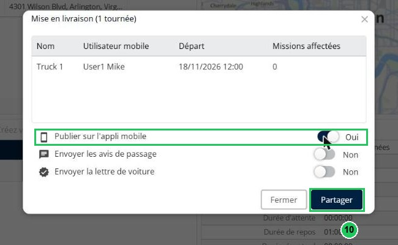

6. Si des conflits sont listés, examinez-les. Pour continuer malgré tout, cliquez sur **Forcer** pour valider.

### Résultat

L’itinéraire validé est publié dans l’application mobile.

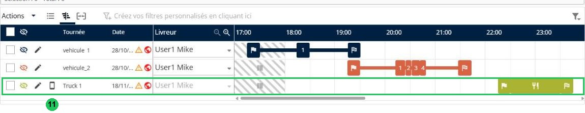

## Rubriques connexes

* [Gestion des sous-traitants](README.md)
* [Affectation des missions au sous-traitant](assigning-missions-to-subcontractor.md)
* [Gérer le profil utilisateur](../manage-users/manage-user-profile.md)
