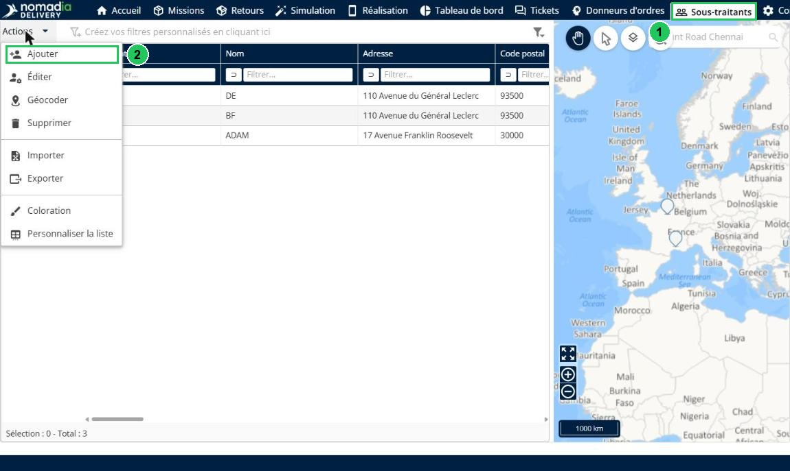
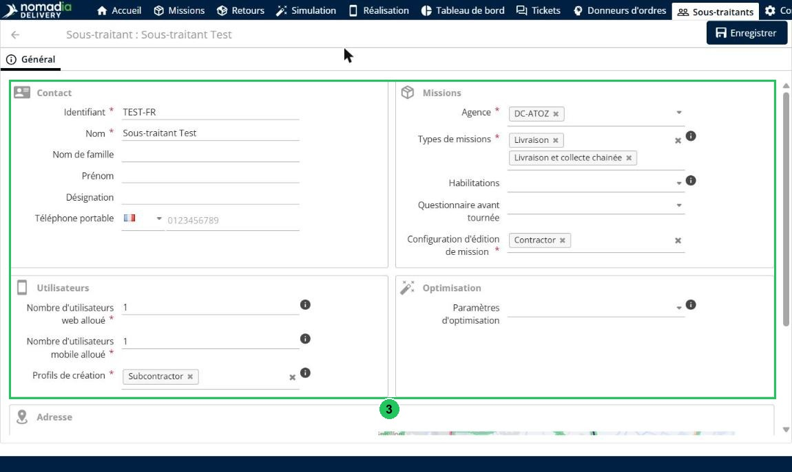
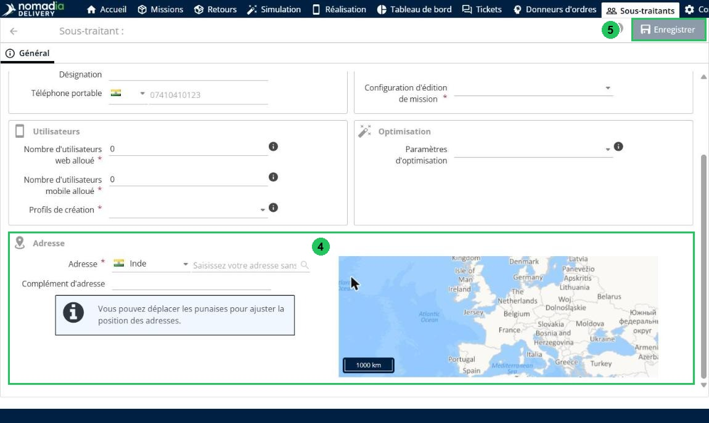
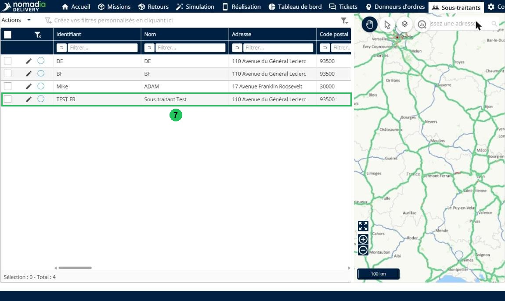
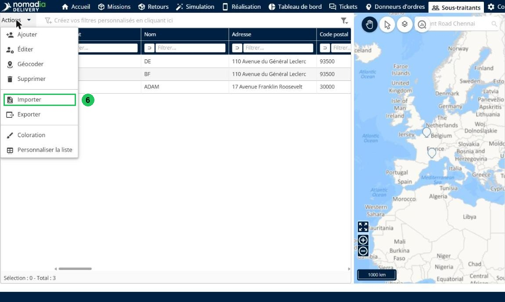

# Enregistrer un sous-traitant

Enregistrez un sous-traitant afin que les transporteurs puissent lui déléguer des tâches logistiques. Après l’enregistrement, le transporteur peut créer l’accès du sous-traitant depuis le module Configuration. Cela permet aux sous-traitants de se connecter au système et d’effectuer leurs tâches.

## Avant de commencer

* Assurez-vous que l’utilisateur dispose des droits nécessaires pour créer et modifier des sous-traitants.

## Présentation de la fonctionnalité

Les champs suivants sont obligatoires lors de l’ajout d’un sous-traitant :

* **Identifiant**
* **Nom du sous-traitant**
* **Adresse du sous-traitant**
* **Types de mission qu’ils peuvent gérer**
* **Utilisateurs web attribués**
* **Utilisateurs mobiles attribués**
* **Profils**
* **Agence**

## Enregistrer un sous-traitant

1. Ouvrez l’application Nomadia Delivery et accédez au module **Sous-traitants**.
2. Cliquez sur le menu **Actions** et sélectionnez le bouton **Ajouter**.

3. Renseignez les champs obligatoires. Le transporteur peut également saisir des informations supplémentaires telles que la zone et les autorisations. Une fois l’adresse du sous-traitant renseignée, la carte met automatiquement en évidence sa localisation géographique.

4. Cliquez sur **Enregistrer** pour ajouter le sous-traitant au système de gestion des livraisons.

### Résultat

Le sous-traitant est ajouté et apparaît dans la liste des sous-traitants.

## Importer des sous-traitants en masse

Vous pouvez également importer des sous-traitants en masse via un fichier Excel, ce qui permet de gagner du temps et de l’effort lors de l’ajout de plusieurs entrées.

## Conseils


**Import en masse** : pour ajouter plusieurs sous-traitants à la fois, importez-les via un fichier Excel au lieu de les ajouter un par un.



**Champs obligatoires** : renseignez tous les champs obligatoires listés dans la présentation de la fonctionnalité avant de cliquer sur **Enregistrer**.


## Rubriques connexes

* [Gestion des sous-traitants](README.md)
* [Créer un utilisateur sous-traitant](create-a-subcontractor-user.md)
* [Affectation des missions au sous-traitant](assigning-missions-to-subcontractor.md)
