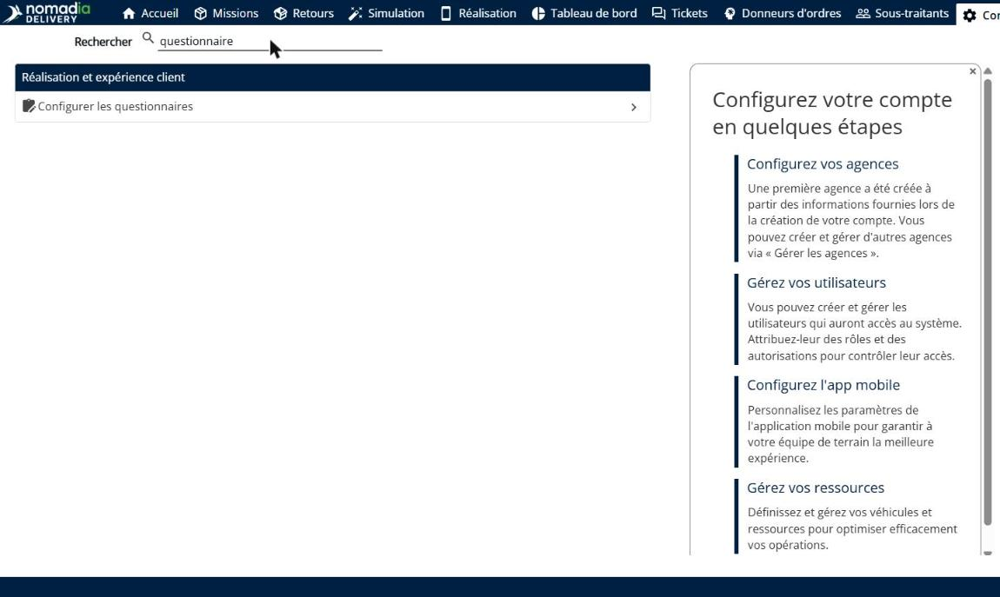
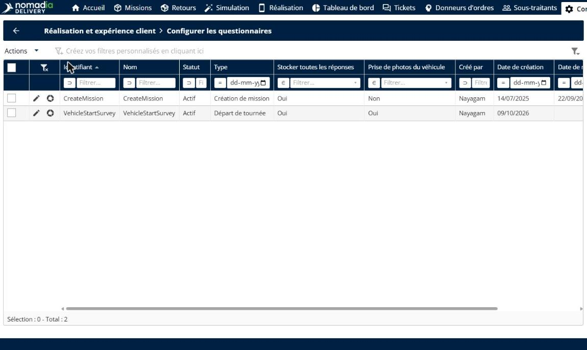
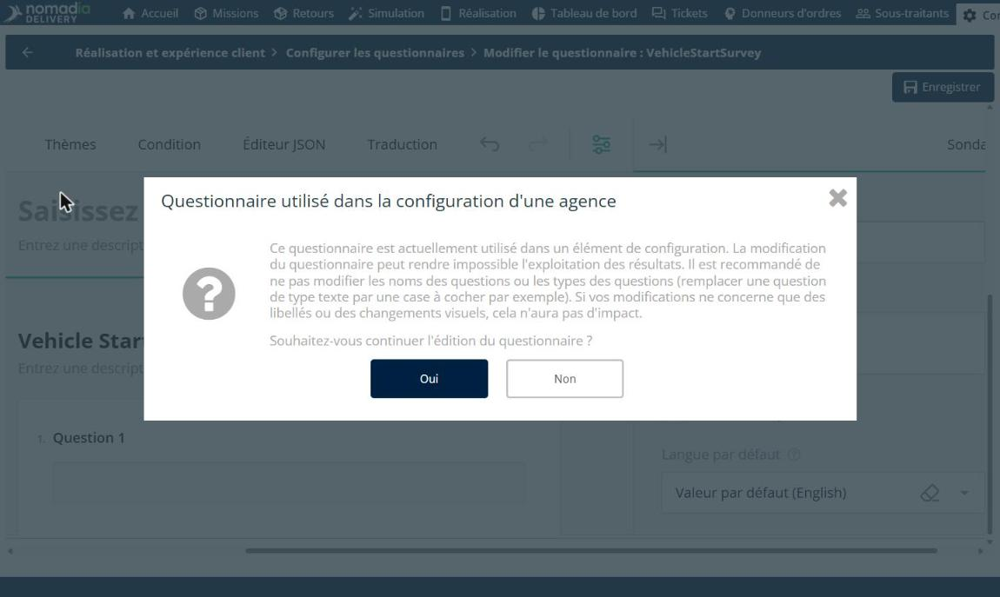
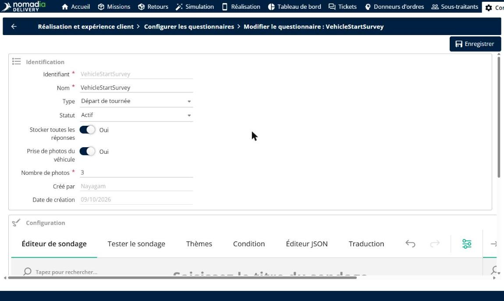
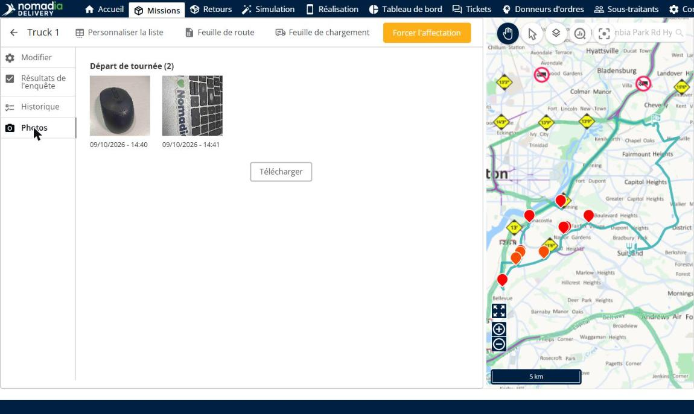
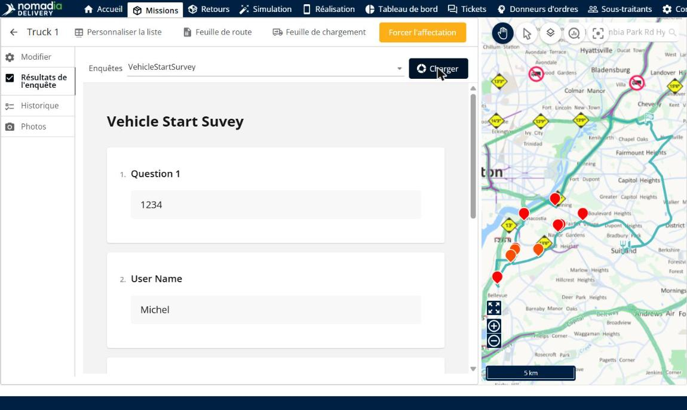

# Photos de l’état du véhicule

Les photos de l’état du véhicule permettent aux chauffeurs de photographier leur véhicule au départ et à la fin de la tournée avec l’appareil photo de l’application, juste après le questionnaire du véhicule. Les photos sont enregistrées sur la tournée : les exploitants peuvent vérifier l’état du véhicule d’un coup d’œil dans l’onglet **Photos** de la tournée, sans papier ni photos sur des téléphones personnels.

## Avant de commencer

* Connectez-vous à **Nomadia Delivery** avec un profil utilisateur ayant accès à la page **Configuration**.
* Assurez-vous qu’un questionnaire de départ ou de fin de tournée existe. Voir [Configuration de sondages personnalisés](configuring-customized-surveys.md).

## Présentation de la fonctionnalité

* **Configurer les questionnaires** : page de **Configuration**, dans la section **Réalisation et expérience client**, qui répertorie vos questionnaires. La colonne **Prise de photos du véhicule** indique les questionnaires qui demandent des photos du véhicule.
* **Prise de photos du véhicule** : option du questionnaire qui demande aux chauffeurs de prendre des photos du véhicule après le questionnaire.
* **Nombre de photos** : nombre maximal de photos que le chauffeur prend, par exemple **3**.
* **Appareil photo de l’application** : appareil photo de l’application mobile qui s’ouvre après le questionnaire, par exemple pour le compteur kilométrique, l’extérieur et les pneus.
* **Onglet Photos** : onglet de la tournée où les photos du véhicule sont enregistrées, avec leur date et leur heure.
* **Onglet Résultats de l’enquête** : onglet de la tournée où les réponses au questionnaire sont enregistrées.

## Activer les photos du véhicule dans un questionnaire

1. Accédez à **Configuration**, recherchez **questionnaire**, puis cliquez sur **Configurer les questionnaires**.

2. Dans la liste des questionnaires, consultez la colonne **Prise de photos du véhicule**, puis cliquez sur l’**icône crayon** à côté du questionnaire de départ ou de fin de tournée, par exemple de type **Départ de tournée**.

Si le questionnaire est utilisé dans la configuration d’une agence, un message vous demande de confirmer la modification. Cliquez sur **Oui** pour continuer.

3. Activez **Prise de photos du véhicule**, puis saisissez le **Nombre de photos**.

4. Sous **Configuration**, dans l’**Éditeur de sondage**, définissez les questions auxquelles le chauffeur répond avant de prendre les photos, par exemple le relevé du compteur kilométrique.
5. Cliquez sur **Enregistrer**.

### Résultat

Au départ ou à la fin de la tournée, après le questionnaire, l’application mobile ouvre l’appareil photo. Le chauffeur prend jusqu’au nombre de photos configuré, par exemple du compteur kilométrique, de l’extérieur et des pneus.

## Consulter les photos du véhicule d’une tournée

1. Sur la page **Missions**, ouvrez la tournée, par exemple **Truck 1**.
2. Cliquez sur l’onglet **Photos**. Les photos sont regroupées par questionnaire, par exemple **Départ de tournée**, avec leur date et leur heure.
3. Pour enregistrer les photos, cliquez sur **Télécharger**.

4. Pour voir les réponses du chauffeur, cliquez sur l’onglet **Résultats de l’enquête**, choisissez le questionnaire dans **Enquêtes**, puis cliquez sur **Charger**.

## Conseils


**Limitez le nombre de photos** : ne demandez que les photos utiles, comme le compteur kilométrique, l’extérieur et les pneus, afin que les chauffeurs puissent démarrer leur tournée rapidement.



**Questionnaire déjà utilisé** : si le questionnaire est utilisé dans la configuration d’une agence, ne modifiez pas les noms ni les types des questions, sinon les résultats existants risquent de ne plus pouvoir être exploités. Les changements de libellés ou visuels n’ont pas d’impact.


## Rubriques connexes

* [Configuration de sondages personnalisés](configuring-customized-surveys.md)
* [Éditeur d’itinéraire](routes/routeeditor.md)
